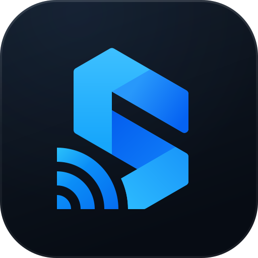
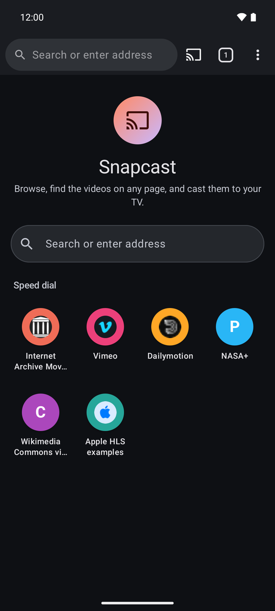
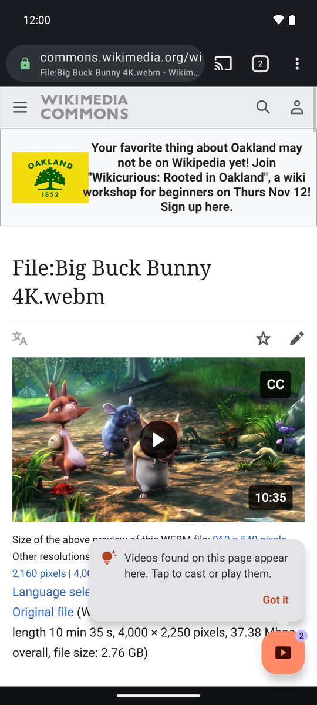
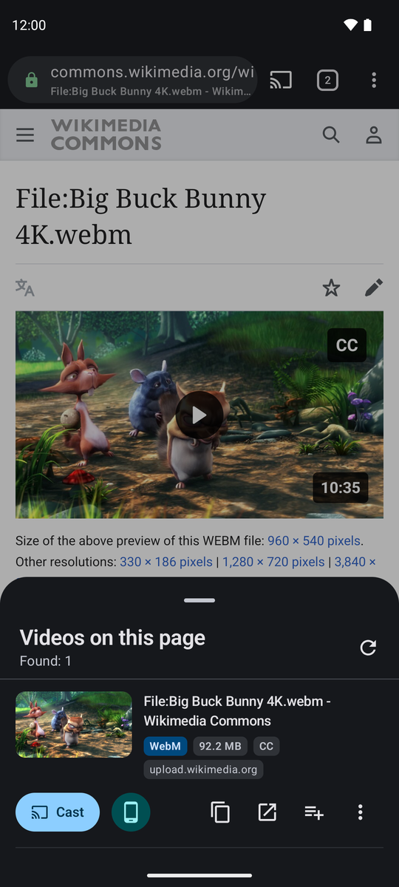
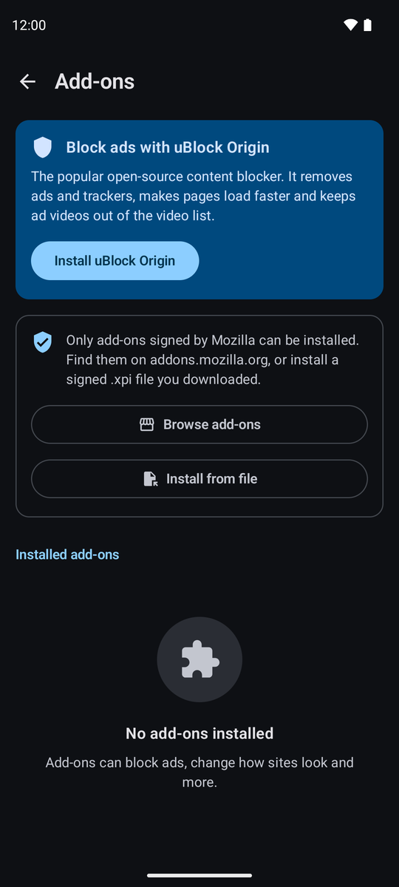

<p align="center">
  
</p>

<h1 align="center">Snapcast</h1>

<p align="center">
  A web browser for Android that finds the videos on any page and casts them to your TV.
</p>

<p align="center">
  <a href="https://github.com/Zoryc/Snapcast/actions/workflows/ci.yml"></a>
  
  
</p>

<p align="center">
  
  &nbsp;
  
  &nbsp;
  
  &nbsp;
  
</p>

Snapcast is built on Mozilla **GeckoView**. While you browse, it spots the video streams on the page
and lists them behind a floating button. One tap sends a video to a **Chromecast**. Casting goes
through a small proxy on the phone that replays the browser's own request headers (Referer, cookies,
User-Agent), so streams that refuse anonymous requests still play on the TV. Firefox add-ons such as
**uBlock Origin** install straight from addons.mozilla.org.

## Download

Get the latest APK from [Releases](https://github.com/Zoryc/Snapcast/releases): pick
`snapcast-<version>-arm64-v8a.apk` for almost every modern phone. Builds of every commit are also
available as artifacts of the [CI workflow](https://github.com/Zoryc/Snapcast/actions/workflows/ci.yml).

## Features

* **Browser**: tabs and private tabs, address bar with search and suggestions, history, bookmarks, a
  speed-dial home page, desktop mode, downloads, site permission prompts, file pickers, fullscreen
  video, popups and the HTTPS lock indicator.
* **Video detection**: a bundled WebExtension watches network responses (by URL pattern and
  Content-Type) and scans `<video>`/`<source>`/`<track>` elements in every frame. It captures the
  headers needed to replay each stream. HLS segments are folded under their playlist, master playlists
  are parsed for qualities, and tiny files and ad domains are filtered out. DRM is detected and
  explained instead of attempted.
* **Video list**: a floating button with a live count that pulses when something new is found. It
  opens a sheet with thumbnails, type (HLS/DASH/MP4…), quality, size or duration and source. Each video
  can be cast, played on the phone (Media3), copied, opened in another app or queued.
* **Chromecast**: discovery through the Cast button, the Default Media Receiver, and a local proxy at
  `http://<phone-ip>:<port>/stream/<id>`. The proxy handles Range, HEAD and CORS, streams without
  buffering, and rewrites HLS/DASH so variants, segments, keys and subtitles also go through it.
  There are mini and expanded controllers (seek, ±10 s, volume, speed, subtitles), a media
  notification with lock-screen controls, a queue, SRT→WebVTT subtitles and resume positions. A
  foreground service keeps the proxy alive while casting. You can also cast directly without the proxy.
* **Add-ons**: install from AMO (the `.xpi` is intercepted) or with one tap for uBlock Origin. You get
  permission prompts, enable/disable, private-window access, options pages and toolbar popups.
  Signature enforcement stays on.
* **Extras**: cast videos stored on the phone, import IPTV `.m3u` playlists, and use
  picture-in-picture for local playback.

## Project layout

| Module | What it contains |
|---|---|
| `app` | Application, `MainActivity`, manifest, theme |
| `ui` | Jetpack Compose (Material 3) screens and ViewModels |
| `browser` | GeckoRuntime, tabs/sessions and all GeckoSession delegates, downloads |
| `detection` | Bundled detector WebExtension (`src/main/assets/extensions/snapcast_detector`) and the native-messaging side |
| `addons` | Add-on management, AMO installs, prompts, popups |
| `cast` | `CastTarget` abstraction, Chromecast implementation, controller, casting foreground service |
| `proxy` | Pure-JVM NanoHTTPD + OkHttp proxy with playlist rewriting |
| `player` | Media3 player activity with picture-in-picture |
| `data` | Room (history, bookmarks, playback positions), DataStore (settings, tabs) |
| `core` | Pure-JVM models and media logic (classification, HLS/DASH parsing, SRT→VTT, M3U) |

See [docs/ARCHITECTURE.md](docs/ARCHITECTURE.md) for how detection and casting flow through the modules.

## Building

Requirements: JDK 21 and the Android SDK with platform `android-37.2`, which GeckoView 158 needs.

```bash
./gradlew assembleDebug          # APKs per ABI in app/build/outputs/apk/debug/
./gradlew :core:test :proxy:test testDebugUnitTest
node --test 'detection/src/test/js/**/*.test.js'   # detector extension tests
```

CI (`.github/workflows/ci.yml`) runs the same commands on every push and uploads the debug APKs
(`snapcast-debug-apks` artifact). Install `app-arm64-v8a-debug.apk` on most phones.

## Versions

GeckoView 158 (latest stable on maven.mozilla.org), AGP 9.4.1, Gradle 9.8.1, Kotlin 2.4.20,
compile/target SDK 37, min SDK 26, Compose BOM 2026.09.00, Media3 1.11.1, Cast framework 22.3.1,
Hilt 2.60.1, Room 2.8.5. All versions live in `gradle/libs.versions.toml`.

## Trying it

* Plain `<video src="….mp4">` pages, e.g. https://www.w3schools.com/html/html5_video.asp
* HLS: https://devstreaming-cdn.apple.com/videos/streaming/examples/img_bipbop_adv_example_fmp4/master.m3u8
  or https://test-streams.mux.dev/x36xhzz/x36xhzz.m3u8
* DASH: https://dash.akamaized.net/akamai/bbb_30fps/bbb_30fps.mpd
* A video inside an iframe: any page embedding a Vimeo or Dailymotion player
* uBlock Origin: install it from *Add-ons*, then open a news site with ads

The phone and the Chromecast must be on the same Wi-Fi network: the TV fetches the stream from the
phone's proxy.

## Limitations

* DRM-protected streams (Widevine/PlayReady/FairPlay) are never cast or played. Snapcast detects them
  and says so.
* Sites that split audio and video into separate adaptive streams for MSE players (for example
  YouTube) cannot be cast with the Default Media Receiver.
* The Default Media Receiver only renders WebVTT text tracks; SRT files are converted on the phone.
